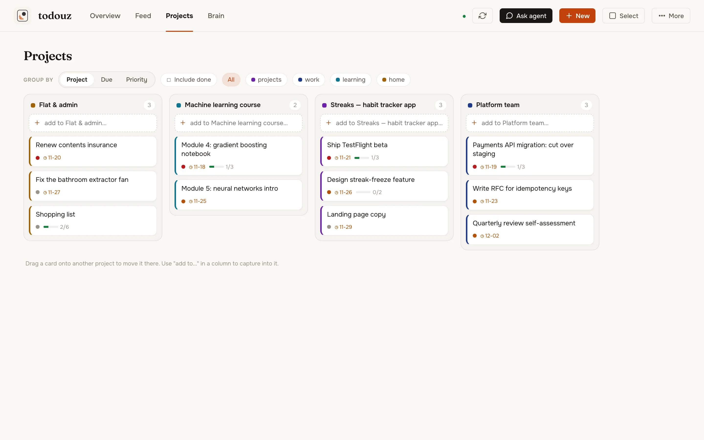
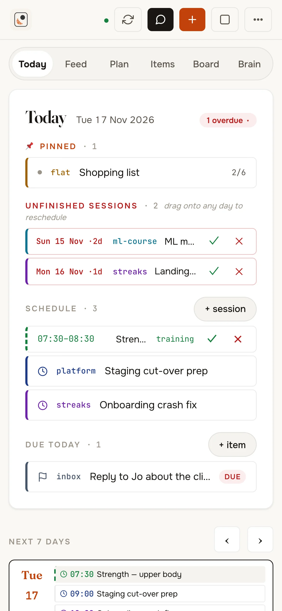
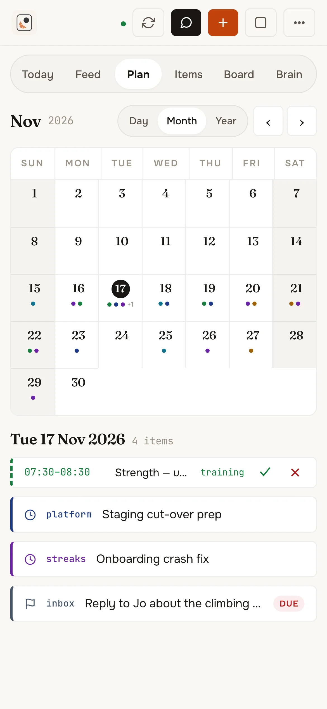

<p align="center">
  
</p>

<p align="center">
  <a href="#quick-start">Quick start</a> ·
  <a href="#connect-your-ai">Connect your AI</a> ·
  <a href="docs/mcp-tools.md">76 MCP tools</a> ·
  <a href="docs/configuration.md">Configuration</a> ·
  <a href="docs/data-model.md">Data model</a>
</p>

<p align="center">
  
  
  
  
</p>

**todouz** is a self-hosted planner for one person (or a small household) that keeps everything in plain markdown files and opens itself to AI agents. You get a calm calendar dashboard for yourself, and an MCP server so Claude Code, Claude Desktop, Cursor or any other agent can read your schedule, add tasks, book focus time and keep notes, from whatever session you are already in.


<sub>Real screenshots running on the built-in demo workspace (`npm run demo`). "Sam" and their projects are made up.</sub>

## What it does for you

- **One place for the day.** Today shows pinned lists, unfinished sessions from earlier days, the schedule and what's due, so nothing quietly disappears.
- **Plan in time, not just lists.** Drag items onto a day or month calendar to book work sessions. Recurring sessions are real, separate blocks you can move or skip.
- **Your agent can do the admin.** "Move my gym to Thursday and book two hours for the RFC before Friday" works from any AI session connected over MCP, or from the built-in **Ask agent** panel.
- **A second brain that every session shares.** The Brain tab keeps decisions, learnings and preferences as linked markdown notes, so your next AI chat starts from what you already know.
- **Files you own.** Every folder is `epic.md` + `issues.md` on disk. Grep it, edit it in your editor, back it up with git. The SQLite index is rebuilt from the files on every boot.
- **Works on your phone.** Installable PWA with a one-view-at-a-time mobile layout and optional push reminders.

## Quick start

You need Node 20 or newer.

```bash
git clone https://github.com/llhtoby38/todouz.git
cd todouz
npm install
npm run demo
```

Open <http://localhost:8765/dashboard/>. `npm run demo` fills a separate `./demo-data` folder with a fictional workspace and starts the server on it, so you can click around before adding anything of your own.

When you are ready to use it for real:

```bash
npm start                 # uses ./data (created empty on first run)
mkdir -p data/skills && cp examples/skills/*.md data/skills/   # optional starter playbooks for the agent
```

Then open the **Profile** note at the top of the **Brain** tab and tell it who you are, or edit `data/personal/profile.md` directly.

<details>
<summary><b>Let your AI set it up for you</b></summary>

Paste this into Claude Code (or any agent that can run commands) in the folder where you keep projects:

```text
Clone https://github.com/llhtoby38/todouz, run npm install, start it with npm start
in the background, then register its MCP server with this Claude Code session
(claude mcp add todouz "$(which node)" <absolute path>/mcp-server/index.mjs).
Open http://localhost:8765/dashboard/ and ask me three questions to fill in
data/personal/profile.md: what I'm working on, how I like to plan, and my timezone.
```

</details>

## Connect your AI

The dashboard, the HTTP API and the MCP server share one tool catalogue, so an agent can do anything you can do in the UI.

**Claude Code**

```bash
claude mcp add todouz "$(which node)" "$(pwd)/mcp-server/index.mjs"
```

**Claude Desktop, Cursor and other MCP clients** — add to the client's MCP config:

```json
{
  "mcpServers": {
    "todouz": {
      "command": "/absolute/path/to/node",
      "args": ["/absolute/path/to/todouz/mcp-server/index.mjs"]
    }
  }
}
```

Use the absolute path to `node`: desktop apps on macOS don't inherit your shell `PATH`.

Then, from any session:

> Use todouz. What's on today, and is anything overdue?

**Plain HTTP** works too, for scripts or AIs without MCP: every tool is `POST /api/<tool_name>` with a JSON body, and a personal key from Settings → Account as a bearer token. See the full list in [docs/mcp-tools.md](docs/mcp-tools.md).

**Ask agent** inside the dashboard runs Claude with the same tools. It uses your signed-in [Claude Code](https://docs.claude.com/en/docs/claude-code/quickstart) CLI (so it bills to your existing plan), or an Anthropic API key you add in Settings.

## A tour

| | |
|---|---|
|  **Calendar.** Day, month and year views. Sessions show their time, deadlines show a flag; drag either to reschedule. |  **Item drawer.** Description in markdown (WYSIWYG editor), checklist, attachments, nested items, booked sessions and an "Ask AI" button scoped to this item. |
|  **Projects.** A board of the folders you choose, grouped by project, due date or priority. |  **Brain.** Typed notes (decision, learning, concept, preference…) that the agent reads first and links to each other. |
|  **Feed.** A short-post feed for your daily brief and anything your agent wants you to read later, with one-tap triage for overdue items. |  <br>**Phone.** One view at a time, installable as an app. |

## How it works


- **Markdown is the source of truth.** Folders (`data/epics/<category>/<folder>/`) hold `epic.md` for slow-changing context and `issues.md` for items, each a `## ISS-NNN` section with metadata and a checklist. The calendar, completion log and settings live in small JSON files under `data/state/`. [Data model →](docs/data-model.md)
- **SQLite is only an index.** `data/state/index.db` is rebuilt from the files at boot, so hand edits and git pulls are always picked up.
- **Skills teach the agent your habits.** Markdown playbooks in `data/skills/` (shopping lists, meal plans, work logs, evidence screenshots…) tell any agent how you like things done. The agent can write new ones when you teach it a workflow.
- **Routines are opt-in.** Scheduled prompts in `data/routines/` can write a morning brief, fill the feed or tidy the Brain. They only run on a schedule when you set `TODOUZ_ROUTINES=on`, because they use your Claude plan.

## Self-hosting

For a server or a shared household install, turn on accounts. Each person then gets their own lists, calendar, Brain and feed, and only what they share is visible to others.

```bash
cp .env.example .env    # set TODOUZ_USERS=alex:a-long-password, TODOUZ_SECRET, TODOUZ_TZ
docker compose up -d
```

Without any accounts the server only listens on `127.0.0.1`. Every tool call runs as the caller, whether it comes from the dashboard, the API, an MCP client or the agent. [All settings →](docs/configuration.md)

## Good to know

- todouz is a personal tool that grew from daily use, not a hosted product. Back up `data/` (git works well) before big changes.
- Item ids are per folder: `ISS-001` can exist in two folders, so tools always take the folder too.
- The agent can create, move and complete things. It is told to act first and summarise, so review its summary, and use the item's work log to see what changed.
- Background AI jobs cost tokens on your Claude plan. They are all off by default.

## Project layout

```
dashboard/     React UI served as static files (no build step)
mcp-server/    Express server, MCP stdio server and the tool catalogue
scripts/       seed-demo.mjs (demo workspace), gen-tool-docs.mjs
examples/      starter skills to copy into data/skills/
docs/          configuration, data model, generated tool reference
data/          your workspace (git-ignored by default)
```

## Credits

The Brain's nebula view and the idea of typed links between notes are adapted, with permission, from [Adam Chan](https://github.com/Adamchanadam)'s Creative Second Brain. The README layout takes inspiration from his [Agent Handoff Kit](https://github.com/Adamchanadam/agent-handoff-kit).

Built by [Toby Lee](https://github.com/llhtoby38) with Claude Code.

## Licence

[MIT](LICENSE)
