<p align="center">
  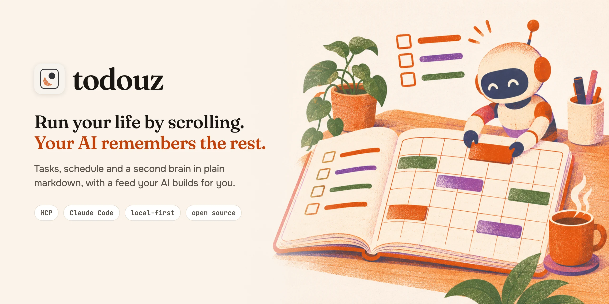
</p>

<p align="center">
  <a href="#quick-start">Quick start</a> ·
  <a href="#connect-your-ai">Connect your AI</a> ·
  <a href="docs/mcp-tools.md">MCP tools</a> ·
  <a href="docs/roadmap.md">Roadmap</a> ·
  <a href="docs/configuration.md">Configuration</a>
</p>

<p align="center">
  
  
  
  
</p>

**todouz is a friendly home for your tasks, schedule and life context, built for the age of AI agents.** You plan your day in a calm dashboard. Your AI reads the same files, so it already knows your goals, projects and preferences when you ask it for help. And instead of an endless social feed, you scroll a feed your AI writes for you: today's brief, tasks to triage with one tap, and the ideas you asked for.

<p align="center">
  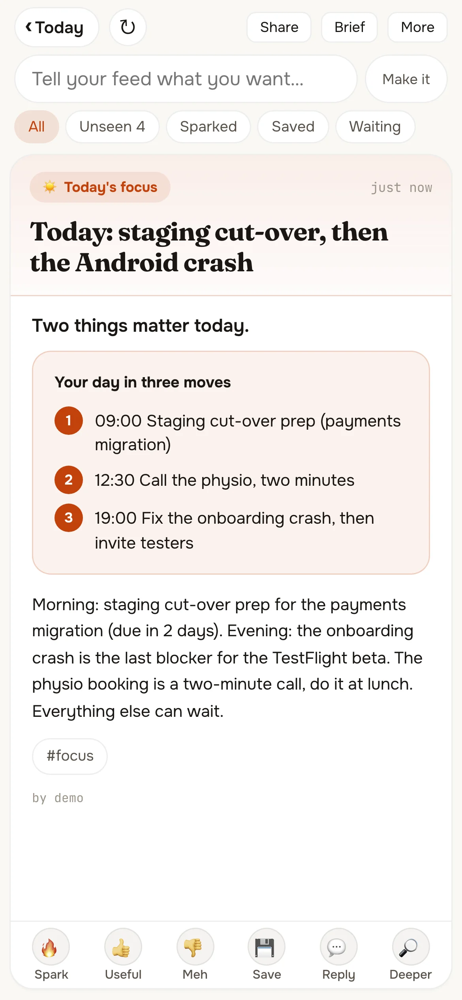
  &nbsp;
  
  &nbsp;
  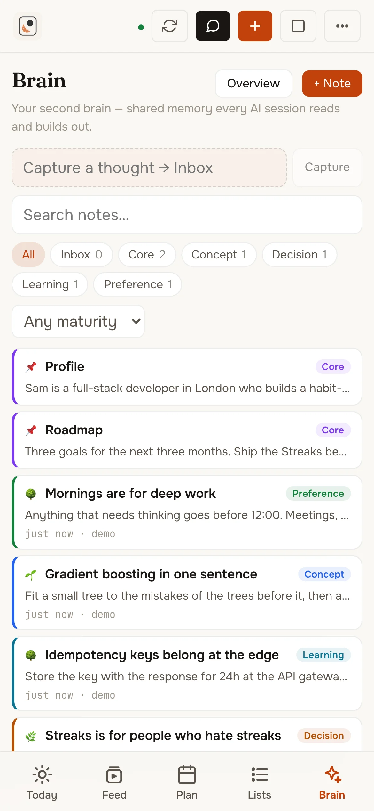
</p>

<sub>Screenshots from the built-in demo (`npm run demo`). "Sam" and their projects are made up.</sub>

## Plan, remember, scroll

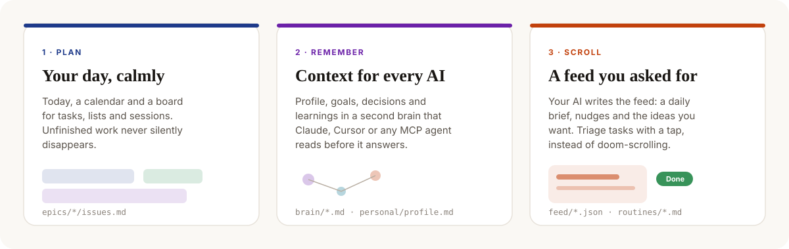

**Plan.** Today shows what's pinned, what you didn't finish yesterday, what's booked and what's due. Drag items onto a calendar to book time; a board shows the projects you care about.

**Remember.** The Brain holds your profile, goals, decisions and learnings as linked markdown notes. Every AI you connect reads it first, so no chat starts from zero, and anything durable it learns gets written back.

**Scroll.** The Feed is a short-post feed made for you. Your AI writes a morning brief, resurfaces notes you'd forgotten, connects your projects, and posts the things you ask for ("one weekend hike idea a week", "summaries of new ML papers"). Overdue tasks show up as cards you clear with Done, Tomorrow or Drop. Tell it what you want in plain words and it learns from what you spark or skip.

## Why not Notion, Obsidian or a to-do app?

| | todouz | Notion | Obsidian | Todoist / TickTick |
|---|---|---|---|---|
| Built for AI agents to use | **Yes, 74 MCP tools + HTTP API** | AI inside Notion | Via community plugins | REST API, no agent context |
| One context layer every AI reads | **Profile + Brain, read first** | Per workspace | Your vault, if a plugin reads it | No |
| A feed instead of a list | **Brief, triage, ideas you ask for** | No | No | No |
| Tasks with a real schedule | **Items, sessions, calendar, board** | Databases you build | Plugins | Tasks, basic calendar |
| You own the data | **Plain markdown on your disk** | Cloud | Markdown on your disk | Cloud |
| Price | **Free, self-hosted** | Subscription | Free core | Subscription |

todouz is not a general wiki or a team tool. It is a personal life OS that stays small and opinionated: one person (or a household), their day, their context, and the agents that help them.

## What's in the MVP

- **Today** with pinned lists, unfinished sessions, schedule and due items
- **Plan**: day, month and year calendar with drag to reschedule; recurring sessions as real blocks
- **Lists and a Board** of folders, items, checklists and nested items, with a WYSIWYG markdown editor
- **Brain**: profile, roadmap and typed notes (decision, learning, concept, preference, person, source)
- **Feed**: daily brief, one-tap triage, "tell your feed what you want", reactions that steer it, share-a-link to file things into the Brain
- **Ask agent** in the app, plus an **MCP server** and **HTTP API** for any other agent
- **Accounts** for a household, **push reminders**, installable **PWA**

Next up is in the [roadmap](docs/roadmap.md): calendar sync, a mobile share sheet, feed sources like RSS and newsletters, and an onboarding flow that interviews you to write your profile.

## A look around

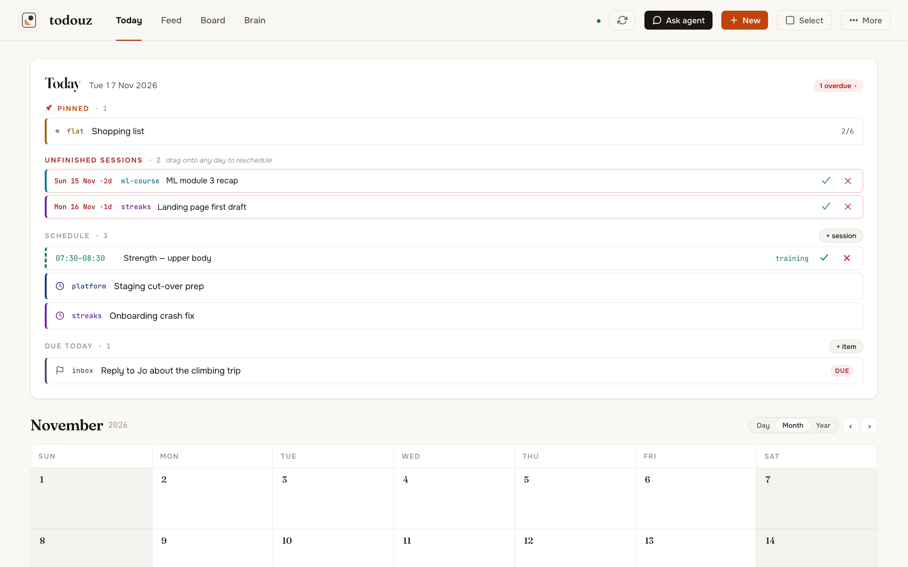

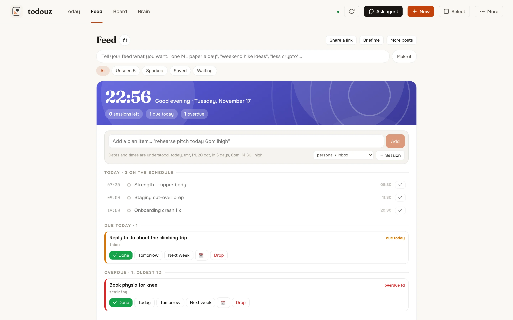

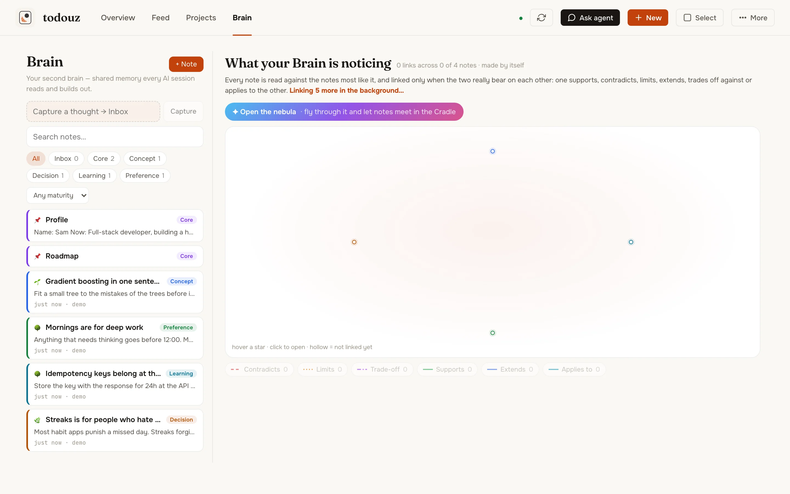

<details>
<summary><b>Calendar, item drawer and board</b></summary>

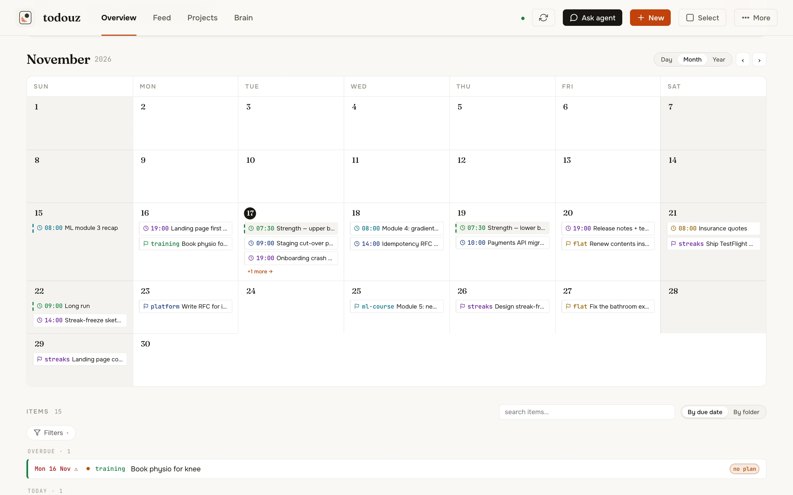

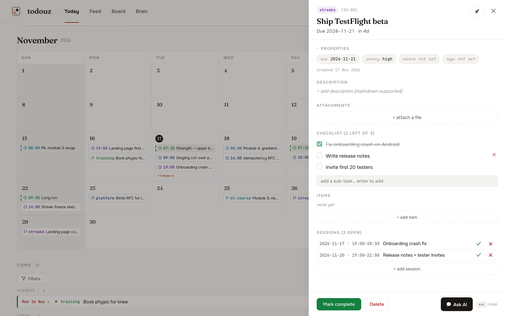

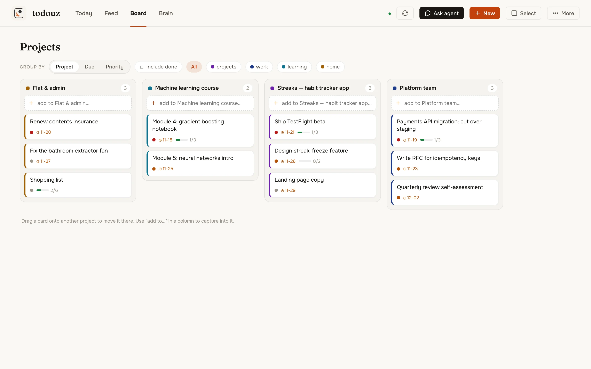

</details>

## Quick start

You need Node 20 or newer.

```bash
git clone https://github.com/llhtoby38/todouz.git
cd todouz
npm install
npm run demo
```

Open <http://localhost:8765/dashboard/>. The demo fills a separate `./demo-data` folder with a fictional workspace, so you can click around first.

When you're ready to use it for real:

```bash
npm start
```

Your data goes in `./data`. Open **Brain → Profile** and write a few lines about yourself, or let your agent interview you (below). Optional starter playbooks for the agent: `mkdir -p data/skills && cp examples/skills/*.md data/skills/`.

<details>
<summary><b>Let your AI set it up for you</b></summary>

Paste this into Claude Code (or any agent that can run commands):

```text
Clone https://github.com/llhtoby38/todouz, run npm install, start it with npm start
in the background, then register its MCP server with this session
(claude mcp add todouz "$(which node)" <absolute path>/mcp-server/index.mjs).
Open http://localhost:8765/dashboard/, then interview me with five short questions
and write my answers into my todouz profile and roadmap.
```

</details>

## Connect your AI

The dashboard, the HTTP API and the MCP server share one tool catalogue, so an agent can do anything you can do in the UI.

**Claude Code**

```bash
claude mcp add todouz "$(which node)" "$(pwd)/mcp-server/index.mjs"
```

**Claude Desktop, Cursor and other MCP clients**: add this to the client's MCP config, with absolute paths (desktop apps on macOS don't inherit your shell `PATH`).

```json
{
  "mcpServers": {
    "todouz": {
      "command": "/absolute/path/to/node",
      "args": ["/absolute/path/to/todouz/mcp-server/index.mjs"]
    }
  }
}
```

Then, from any session:

> Use todouz. What's on today? Book two hours for the RFC before Friday, and remember that I prefer deep work before noon.

**Plain HTTP** works for scripts: every tool is `POST /api/<tool_name>` with a JSON body and a personal key from Settings → Account. **Ask agent** inside the dashboard runs Claude with the same tools, using your signed-in [Claude Code](https://docs.claude.com/en/docs/claude-code/quickstart) CLI or an API key.

## How it works

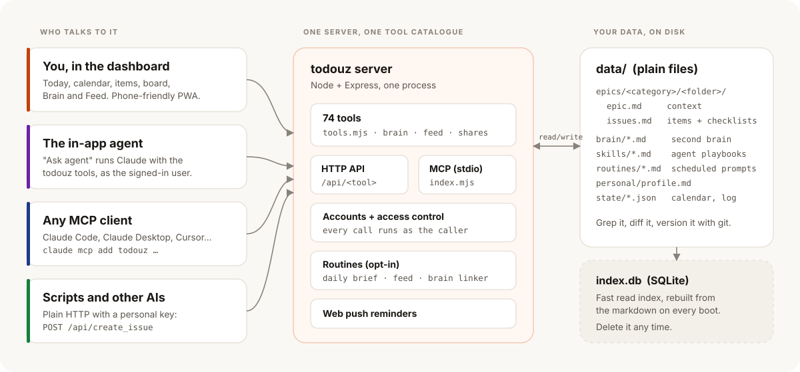

- **Markdown is the source of truth.** Folders hold `epic.md` (context) and `issues.md` (items, one `## ISS-NNN` section each). Calendar, feed and settings are small JSON files. [Data model →](docs/data-model.md)
- **SQLite is only an index**, rebuilt from the files on boot, so hand edits and `git pull` just work.
- **Skills** in `data/skills/` teach any agent your habits (shopping lists, meal plans, work logs).
- **Routines** in `data/routines/` write the brief and fill the feed on a schedule. They are off until you set `TODOUZ_ROUTINES=on`, because they use your Claude plan.
- **Every call runs as the caller**, whether it comes from the dashboard, the API, an MCP client or the agent, so a household can share one install with private lists and notes.

## Self-hosting

```bash
cp .env.example .env    # set TODOUZ_USERS=alex:a-long-password, TODOUZ_SECRET, TODOUZ_TZ
docker compose up -d
```

Without accounts the server only listens on `127.0.0.1`. [All settings →](docs/configuration.md)

## Good to know

- todouz grew out of daily personal use. Back up `data/` (git works well) before big changes.
- The agent acts first and then summarises. Each item keeps a work log of what changed.
- Background AI is off by default. Turn on only the routines you want.

## Project layout

```
dashboard/     React UI served as static files (no build step)
mcp-server/    Express server, MCP stdio server and the tool catalogue
scripts/       seed-demo.mjs, gen-tool-docs.mjs
examples/      starter skills for data/skills/
docs/          roadmap, configuration, data model, tool reference
```

## Credits

Built by [Toby Lee](https://github.com/llhtoby38) with Claude Code. The idea of typed links between Brain notes, and this README's layout, owe a lot to [Adam Chan](https://github.com/Adamchanadam)'s Creative Second Brain and [Agent Handoff Kit](https://github.com/Adamchanadam/agent-handoff-kit).

## Licence

[MIT](LICENSE)
