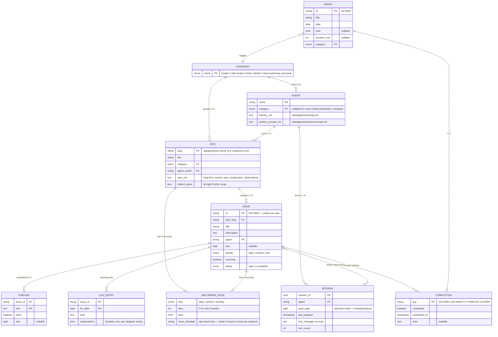
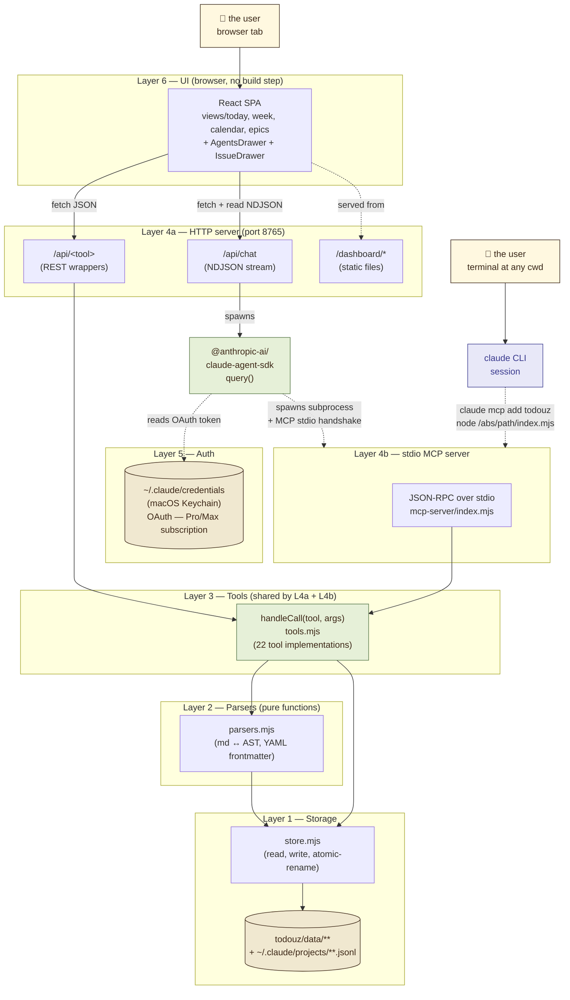
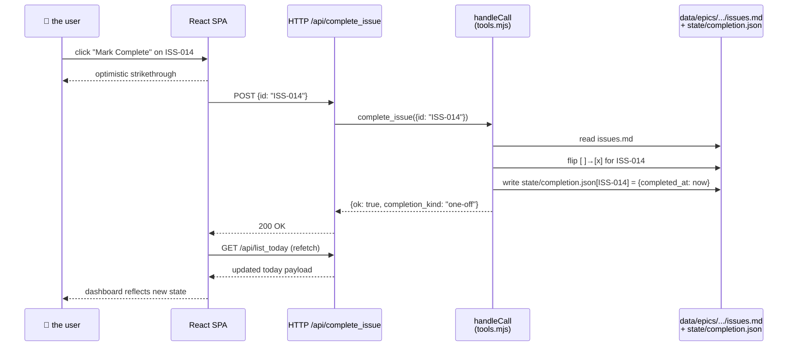
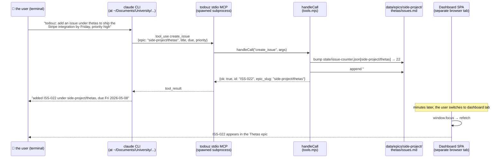
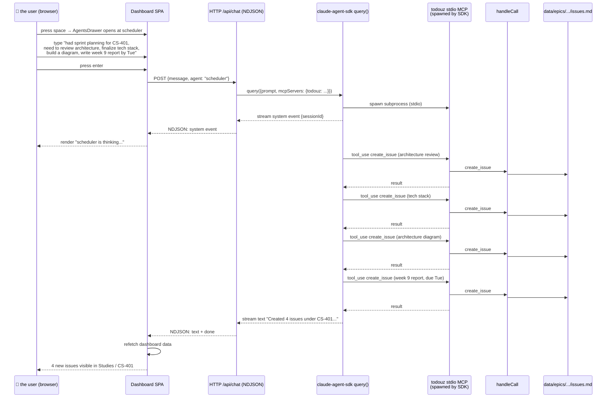
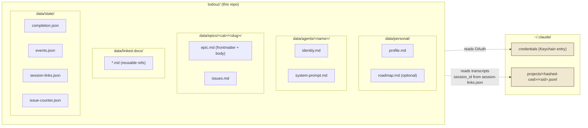

# 00 — Diagrams

Visual reference for the spec. Read this **before** the prose docs to get oriented.

All diagrams are Mermaid — render natively in GitHub, VS Code, Obsidian, and most markdown viewers.

---

## A. Entity-relationship diagram

The conceptual relational model. **On disk we denormalise** (sub-tasks live inside an issue's markdown, completion state is one JSON file, etc.) — see notes below.

### How it actually lives on disk

The relational view is the **mental model**. The on-disk form is denormalised for hand-editability:

| Conceptual entity | On-disk form |
|---|---|
| `CATEGORY` | folder name under `data/epics/<category>/` and `data/agents/<name>/` |
| `AGENT` | `data/agents/<name>/{identity,system-prompt}.md` |
| `EPIC` | `data/epics/<cat>/<slug>/epic.md` (frontmatter + body) + sibling `issues.md` |
| `RECURRING_RULE` | YAML frontmatter inside `epic.md` (epic-level) or inside the issue's metadata block (issue-level) |
| `ISSUE` | one `## ISS-NNN` section inside the epic's `issues.md` |
| `SUBTASK` | `### Sub-tasks` block of nested `- [ ]` checkboxes inside the issue |
| `LOG_ENTRY` | `### Log` block inside the recurring issue, one bullet per date |
| `SESSION` | JSONL at `~/.claude/projects/<hashed-cwd>/<sid>.jsonl` (managed by Claude Code SDK) — referenced, not duplicated |
| `COMPLETION` | one entry in `data/state/completion.json` keyed by `id` or `id#date` or `evt-id` |
| `EVENT` | one entry in `data/state/events.json` |

We trade SQL JOINs for `git diff`-readability and crash-resilience. Acceptable for a single-user system.

---

## B. Architecture / components diagram

Two entry points (browser + external Claude session), one shared dispatcher, one filesystem.

### Three running processes (worth being explicit)

1. **`todouz-server`** (long-running): the dashboard's HTTP server. Hosts L4a + L6 statics. Started by `node mcp-server/http-server.mjs` or via launch.json. Listens on 8765.
2. **stdio MCP subprocess** (per-chat or per-claude-session): spawned on demand. Two ways it gets spawned:
   - The dashboard's `/api/chat` calls `query()` from the SDK, which spawns one for the duration of that chat.
   - An external `claude` session at any cwd spawns one when `claude mcp` resolves the `todouz` server entry.
3. **External `claude` CLI** (when used): the user's terminal. Independent auth, independent cwd. Talks to its spawned MCP subprocess.

Crucially: **all three forms route through the same `tools.mjs` dispatcher**. There's no second copy of the business logic.

### Why both stdio MCP *and* HTTP?

Different consumers want different transports:

- The dashboard SPA can't speak stdio MCP. It needs HTTP/REST.
- An external `claude` CLI session can't easily talk to a long-running HTTP server (auth, port discovery, etc.). It speaks MCP stdio natively.

Same code, two adapters at L4. The dashboard's `/api/chat` is a special case because it needs to *spawn an agent* (the SDK), not just call a tool — so it's an extra adapter layered on top.

---

## C. Sequence — dashboard marks an issue done (F1)

---

## D. Sequence — external Claude session creates an issue (F5)

The MCP-as-tool flow. the user is in his terminal, working on something else, and asks his current Claude session to drop a note into todouz.

This works *without the dashboard server running* — the stdio MCP touches the filesystem directly. When the dashboard does come back up, it sees the new state on first read.

---

## E. Sequence — capture-to-cards via dashboard agent chat (F2)

The "press space, dump a paragraph, watch the agent create the right issues" flow.

---

## F. Storage map — where every byte lives

---

## What I want sign-off on (before any code lands)

1. **Diagram A (ER)** — does the entity model match how you think about your work?
2. **Diagram B (architecture)** — are the layers right? Anything missing?
3. The **two-entry-point design** in Diagram B (browser + external Claude CLI both hitting the same dispatcher). Worth the small extra complexity vs. just dashboard-only?
4. **Issue id scope** — `ISS-NNN` per-epic (readable, but cross-epic moves renumber) vs. global (`ISS-1042` everywhere, immutable). I picked per-epic. Easy to swap.
5. **Recurring issue model** — separate template + instance vs. one issue with embedded log + per-date completion key. I picked the latter. The body agent can `log_recurrence` to record a session and append to the epic's progression notes in one call.

If A + B match your model, I'll start in this order:
1. `parsers.mjs` (testable in isolation, no IO)
2. `store.mjs` + `tools.mjs` (the 15 MVP tools)
3. `mcp-server/index.mjs` (stdio entry — proves "claude mcp add todouz" works from another cwd)
4. `mcp-server/http-server.mjs` (REST + /api/chat)
5. Dashboard SPA — `today` view first, then `epics`, then drawers
6. Run `scripts/migrate-from-prototype.mjs` against real data
7. Cut over

Each step is observable end-to-end before the next starts.
